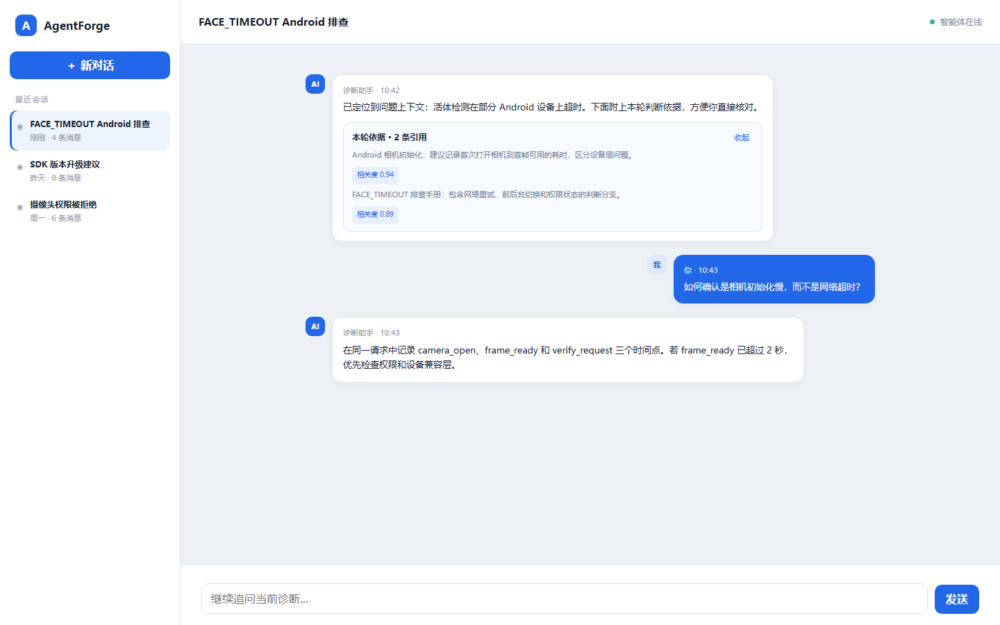
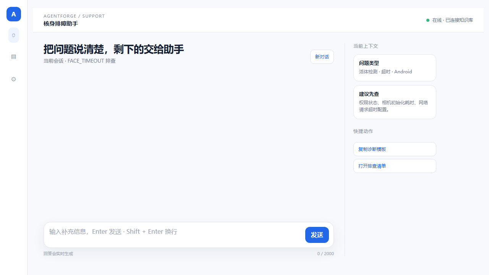
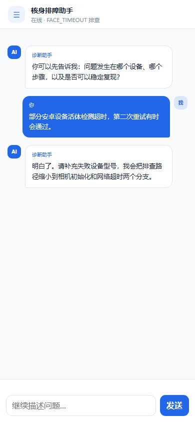

<h1 align="center">AgentForge</h1>

<p align="center">
  <strong>面向企业故障排查的 AI 诊断工作台</strong>
</p>

<p align="center">
  诊断对话 · 知识证据 · Agent 流程
</p>

<p align="center">
  <a href="#项目预览">项目预览</a> ·
  <a href="#核心能力">核心能力</a> ·
  <a href="#运行结构">运行结构</a> ·
  <a href="#快速开始">快速开始</a> ·
  <a href="#深入文档">深入文档</a>
</p>

---

AgentForge 将问题诊断、知识检索和流程配置连接在同一个工作台中，重点关注**可检查的诊断证据、可回归的检索质量和可复现的流程版本**。
当前诊断样例聚焦核身与身份认证场景；接入其他场景需要准备相应的知识、工具和流程。

项目提供可运行的前端、API、知识库检索和 Agent Runtime。运行时需自行配置 LLM API、数据库和业务知识数据。

## 项目预览

**诊断工作台 · 对话与知识证据**



> 图片来自仓库已有的界面设计稿，展示诊断对话、会话列表和回复中的知识引用；当前运行界面可能有所不同。图中内容为示例。

<details>
<summary>查看更多界面设计：桌面上下文与移动端</summary>

### 桌面上下文

问题背景与快捷动作集中展示，便于围绕同一问题继续补充信息。



### 移动端对话

窄屏下保留连续的诊断对话与输入区域。

<p align="center">
  
</p>

</details>

## 核心能力

| 能力           | 工作内容                                                                                             |
| -------------- | ---------------------------------------------------------------------------------------------------- |
| **诊断对话**   | 流式展示排查过程、知识引用和诊断结果，支持信息补充、工具调用与人工审批。                             |
| **知识与质量** | 管理文档和分块，使用向量与关键词混合检索，通过命中测试和检索回归检查质量；在知识库入口查看用户反馈。 |
| **Agent 流程** | 统一管理一级路由流程与诊断流程，支持草稿、发布、激活、试运行和运行记录。                             |

文档解析支持文本、PDF、Word（DOCX）与图片。管理端提供 Langfuse 外部追踪入口，后端提供追踪、指标与结构化日志。

当前仓库没有附带真实业务数据或经过验证的生产性能指标。

## 运行结构

| 模块                                    | 技术                                | 职责                                                |
| --------------------------------------- | ----------------------------------- | --------------------------------------------------- |
| `apps/customer-service`                 | React / TypeScript / Vite           | 诊断对话与证据展示                                  |
| `apps/data-admin`                       | React / TypeScript / Vite           | 知识库、反馈与统一流程管理                          |
| `apps/server-py`                        | Python / FastAPI / SQLAlchemy / ARQ | 公共 API、认证、知识库、Agent Runtime 与摄取 worker |
| `packages/sdk`、`packages/shared-types` | TypeScript                          | 前端 API 客户端与接口类型                           |
| `packages/ui`、`packages/cui`           | React / TypeScript                  | 共享界面与对话组件                                  |

**当前主运行链路使用 Python 后端。** API、Agent Runtime、摄取 worker、数据库迁移与管理脚本均位于 `apps/server-py`。Node.js 用于前端开发、构建、浏览器测试和本地启动编排；根目录 `pnpm` 后端命令会调用 Python。

<details>
<summary>已有环境与历史迁移说明</summary>

当前数据模型与迁移位于 `apps/server-py/src/models` 和 `apps/server-py/alembic`。
`packages/database/prisma` 保留历史 schema 和 SQL 迁移，用于旧数据库兼容验证。

已有环境配置、上传文件和日志继续保留。旧安装可能仍包含未纳入 Git 的 `dist`、`node_modules` 或构建缓存；判断当前后端入口时，以根目录启动脚本和 `apps/server-py` 为准。

</details>

## 快速开始

下面的路径启动诊断前端、管理端和一个 Python 后端。

### 环境要求

| 依赖                    | 用途                              |
| ----------------------- | --------------------------------- |
| Node.js 20+ / pnpm 9+   | 前端开发、构建与浏览器测试        |
| Python 3.12+ / uv       | API、worker 与数据库工具          |
| Docker Desktop          | 本地 PostgreSQL、Redis 等依赖服务 |
| OpenAI 兼容 LLM API Key | 模型调用                          |

### 1. 安装依赖

```bash
pnpm install
cd apps/server-py
uv sync --locked
cd ../..
```

### 2. 配置环境变量

首次安装时选择对应系统的命令，创建并编辑 `apps/server-py/.env`；已有配置请勿覆盖。

**macOS / Linux**

```bash
cp .env.example apps/server-py/.env
```

**PowerShell**

```powershell
Copy-Item .env.example apps/server-py/.env
```

至少配置以下模型服务参数：

```dotenv
OPENAI_API_KEY=your-api-key
OPENAI_BASE_URL=https://api.openai.com/v1
```

确认 `DATABASE_URL` 指向本地 PostgreSQL。默认 Docker 配置使用 `5434` 端口。

<details>
<summary>配置优先级与追踪入口</summary>

配置优先级为进程环境、`apps/server-py/.env`、根 `.env`、旧 `apps/server/.env`。旧环境文件仅作兼容回退；数据库初始化和升级均由 Python 完成。

管理端追踪链接默认指向 `http://localhost:3000`；需要修改时，在 `apps/data-admin/.env.local` 设置 `VITE_LANGFUSE_URL`。

</details>

### 3. 启动依赖服务

```bash
pnpm infra:up
```

可选检索服务：

```bash
docker compose -f infra/docker/docker-compose.yml --profile search up -d ollama elasticsearch
```

### 4. 初始化数据库

```bash
pnpm db:migrate
pnpm db:check
pnpm db:admin --email admin@agentforge.local
```

### 5. 启动 API 和前端

```bash
pnpm dev
```

| 入口           | 默认地址                           |
| -------------- | ---------------------------------- |
| 诊断前端       | <http://localhost:5173>            |
| 管理端         | <http://localhost:5200>            |
| API 健康检查   | <http://localhost:8000/api/health> |
| Python OpenAPI | <http://localhost:8000/docs>       |

诊断前端和管理端均需要登录。使用上一步创建的管理员账户登录后，可开始诊断对话或管理知识库与流程。

**首次使用检索：** 准备 Embedding 模型或兼容的 Embedding 服务。现有向量为 **1024 维**；OpenAI text-embedding-3 模型会显式请求该维度，其他兼容服务也需返回 1024 维。

**异步摄取：** 设置 `INGESTION_ASYNC_ENABLED=true`，并在另一个终端运行：

```bash
pnpm server:worker
```

`pnpm dev:agent-flows` 可自动选择空闲端口启动两端工作台。

<details>
<summary>仅运行 Python 后端</summary>

### 仅运行 Python 后端

数据库、Redis 与环境变量准备好后，可直接使用 Python 工具链：

```bash
cd apps/server-py
uv sync --locked
uv run python -m src.database upgrade
uv run python -m src.database check
uv run python -m src.dev
```

启用异步摄取时，在另一个终端从 `apps/server-py` 运行 `uv run python -m src.worker`。
后端运行无需安装 Node.js 或 pnpm；更多后端配置见 [Python 后端说明](apps/server-py/README.md)。

</details>

## 验证重点

```bash
pnpm typecheck
pnpm py:test
# 先启动管理端；测试使用模拟 API
pnpm --filter @agentforge/data-admin test:e2e:workbench
```

浏览器测试默认连接 `http://localhost:5201`；使用默认管理端端口时，将 `AGENT_FLOW_ADMIN_URL` 设置为 `http://localhost:5200`。
真实浏览器验收使用独立 `agentforge_test_*` 数据库和 Python 数据夹具，配置方法见开发指南。

检索质量应使用固定测试集比较命中率与排序指标；诊断质量应结合固定故障案例检查结论和证据，再记录时延与成本。仓库包含检索回归接口与自动化测试，尚未提供统一的诊断基准报告。

## 深入文档

| 文档                                            | 内容                                       |
| ----------------------------------------------- | ------------------------------------------ |
| [开发指南](docs/operations/development.md)      | 完整的本地开发流程与质量检查               |
| [Python 后端说明](apps/server-py/README.md)     | 当前 API、Agent Runtime、知识摄取与 worker |
| [架构与路由](docs/architecture/routing.md)      | 当前 Python 请求分类和 Agent 分发          |
| [部署手册](docs/operations/deployment.md)       | 生产环境部署                               |
| [备份与恢复](docs/operations/backup-restore.md) | 数据库备份和恢复                           |

<details>
<summary>历史设计参考</summary>

- [Agent Runtime 历史设计](docs/runtime/execution-runtime-v1.md)：原 TS 执行器设计，文中路径为历史引用。
- [知识混合检索历史设计](docs/architecture/knowledge-hybrid-retrieval.md)：原 TS 检索设计与算法说明，当前实现见 Python 后端说明。

</details>

## 项目状态

AgentForge 当前处于实验阶段，接口、数据模型和运行方式可能发生变化。生产使用前请根据实际业务补充认证、权限、数据隔离、监控和部署配置。

## 许可证

当前仓库未包含 `LICENSE` 文件，许可证尚未声明。公开分发或商用前，请先确认项目授权方式。
